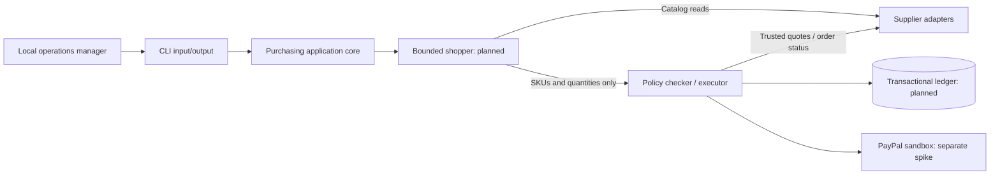
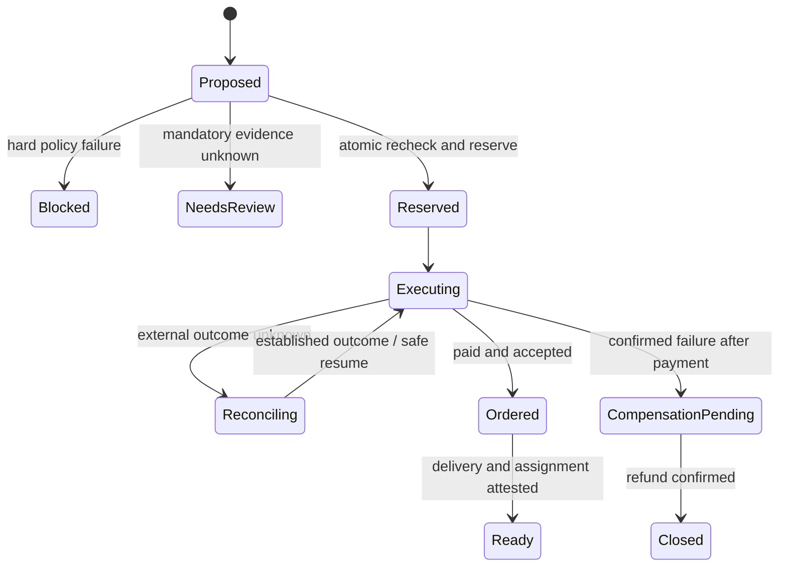

# CLI-first architecture

## Stage-one boundaries

M0 calls the pure checker and fixture supplier in-process. There is no executing
payment service, identity system or deployed process isolation. No website is in stage one.

## Repository map

| Path | Owner/responsibility | State |
| --- | --- | --- |
| `apps/cli/src/` | Argument parsing, file input, readable/JSON results, exit codes | M0 implemented |
| `packages/contracts/src/` | Runtime schemas and shared types | Eligibility slice implemented |
| `config/policies/` | Versioned company policy | Synthetic example |
| `examples/` | Mandate, cart and prior commitments | Synthetic examples |
| `services/checker/src/rules/` | Pure eligibility functions | Implemented |
| `services/checker/src/ledger/` | Atomic reservations and durable operations | Design seam only |
| `services/checker/src/paypal/` | Trusted provider adapter | Existing sandbox client |
| `services/suppliers/src/` | Supplier interface and fixture adapter | Quote slice implemented |
| `services/suppliers/fixtures/` | Synthetic catalog and evidence | Demo data |
| `services/agent/` | Draft parser and bounded shopping loop | Design seam only |

## Technology decisions

Keep Node 24+, erasable TypeScript and ESM. Use Zod for runtime validation and
`node:test` for behavior tests. Node built-ins handle CLI arguments/files; no CLI,
server or agent framework is needed for M0. Stdout in JSON mode contains a single
JSON result; operational errors go to stderr. No frontend dependencies.

Use SQLite transactions for M2's single checker process. Multiple production writers
would require a separate storage decision (likely PostgreSQL). Never hold a long DB
lock over a provider call: reserve and persist intent in a short transaction, then
perform external work through a durable worker and reconcile its outcome.

## Authority and evidence

Policy -> human-confirmed mandate -> price-free cart -> trusted quote -> eligibility
-> atomic reservation -> external execution -> reconciliation -> equipment readiness.

Every edge after eligibility is planned. `BudgetSnapshot` is an offline input, not
a ledger. A real executor loads state from storage, not agent-supplied JSON. A
mandate's `approvedBy` is descriptive fixture metadata, not authentication. The
prototype identity model is a trusted local operator; do not assume it extends to
remote agents or multi-user deployment.

Mandatory evidence has `status`, `source` and `observedAt`; quotes have creation and
expiry times. A source string alone is not authenticity. Production adapters must
verify upstream identity and freshness before producing evidence. Approved exact
SKUs encode company-vetted compatibility; M0 does not certify manufacturer claims.

## Ledger and recovery requirements (planned)

- Unique operation scoped to company, mandate revision and cart identity.
- Atomic amount and per-requirement unit reservations, including prior commitments.
- Payment and order statuses stored independently; one display status is insufficient.
- Operation-specific idempotency keys persisted before external calls. The same key
  with changed parameters must fail locally.
- Verified/deduplicated webhooks and provider reads settle ambiguous outcomes.
  Timeouts preserve reservations; retries resume the original operation.
- Audit events include actor, operation, mandate/policy version, quote digest,
  decisions and provider references. Application-level append-only writes alone
  do not establish tamper evidence.
- Refund/return confirmation does not automatically restore purchasing authority.
- CLI approval must reference exact operation/version/digest and expiry, followed by
  execution-time revalidation. An old `eligible` JSON file is never sufficient.

Conceptual workflow (not an implemented transition engine):

## Test strategy

M0: public-input policy, amount/quantity boundaries, quote binding/expiry, malformed
input, evidence uncertainty and CLI I/O/exit codes. M2: real-storage races and restart
recovery. M3: sandbox payment/order failures and reconciliation. M4: bounded tools and
exact approval authority. M5: delivery, assignment and partial-return scenarios.

All stage-one behavior must be exercisable without a browser. A future website must
reuse these contracts and application operations rather than duplicate business rules.
