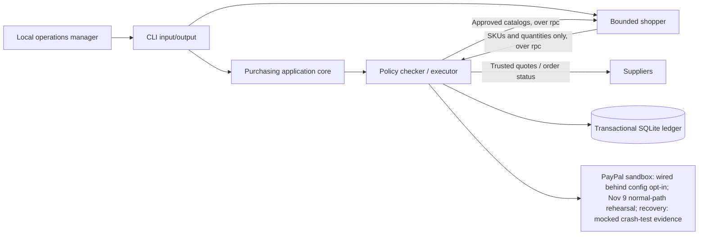
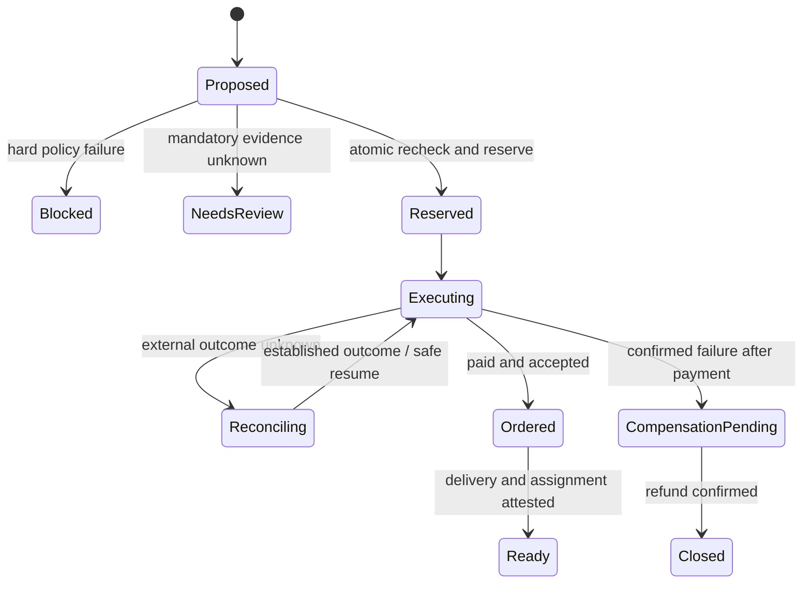

# CLI-first architecture

## Stage-one boundaries

M0 calls the pure checker and fixture supplier in-process. The separate backend CLI
runs durable execution against fake providers by default; the backend config may
select `paymentProvider: "paypal-sandbox"` to route capture/refund effects through
the sandbox gateway (the supplier order stays fake). The shopper is its own CLI entry
point: it reaches the backend through the shared client, over one `rpc` child process
per request, and never holds PayPal credentials. There is no executing payment service,
identity system or deployed process isolation. The one page we serve is the stage-two
read-only dashboard (`npm run dashboard`): a local view built only from read commands, with
no action of its own. The only other browser interaction is PayPal's own hosted
buyer-consent page, reached during the operator's authorized sandbox hold steps or the
sandbox spike.

## Repository map

| Path | Owner/responsibility | State |
| --- | --- | --- |
| `apps/cli/src/` | Argument parsing, file input, readable/JSON results, exit codes | M0, simulation backend CLI and shopper CLI implemented |
| `packages/contracts/src/` | Runtime schemas and shared types | Eligibility slice implemented |
| `config/policies/` | Versioned company policy | Synthetic example |
| `examples/` | Mandate, cart and prior commitments | Synthetic examples |
| `services/checker/src/rules/` | Pure eligibility functions | Implemented |
| `services/checker/src/ledger/` | Mandate authority, atomic reservations and durable operations | Implemented |
| `services/checker/src/execution/` | Durable effect worker and fake providers | Simulation only |
| `services/checker/src/paypal/` | Trusted provider adapter | Existing sandbox client (spike); unit-4/5 gateway wired behind config opt-in with mocked-fetch contract/crash tests. One scripted Windows normal-path authorization/capture rehearsal at `17e917c` was reported Nov 9; account recovery and unused-hold closure remain unverified |
| `services/suppliers/src/` | Supplier interface, fixture quotes and local catalog controls | Offline simulation implemented |
| `services/suppliers/fixtures/` | Synthetic catalog and evidence | Demo data |
| `services/agent/` | Mandate draft/review, written by hand or by a model from plain English; bounded shopper worker over the shared client | Implemented; ten live shopper runs, four against the contract mock and six against the real backend on Windows (four in temporary copies with the folder check skipped, two from the repository with it on), and five live drafting runs |

## Technology decisions

Keep Node 24.15+ or 26+, erasable TypeScript and ESM. Use Zod for runtime validation and
`node:test` for behavior tests. Node built-ins handle CLI arguments/files; no CLI,
server or agent framework is needed for M0. Stdout in JSON mode contains a single
JSON result; operational errors go to stderr. No frontend dependencies: the dashboard is
plain HTML, CSS and JavaScript served by `node:http`, with no build step.

The shopper uses `@anthropic-ai/sdk` through a manual Messages loop rather than an agent
framework, because the worker must own every bound and validate every call itself. This
narrows the framework option in `docs/team-split-and-technology-research.md`. The
worker depends on a provider-neutral model seam, so tests run with no key or network.

`store show/reset/set` controls synthetic working catalogs through the CLI. Supplier
code validates the full change and replaces the working file only after validation;
seed fixtures stay unchanged. Price, shipping, stock, delivery and evidence changes
affect subsequent quotes loaded via `check --catalog`. Explicit offline clocks and
per-field observation updates keep scenarios reproducible without refreshing
unrelated evidence. This file state is not a transaction ledger or stock reservation.

`mandate draft/review` compiles structured hire counts and versioned kit templates
under the supplied policy. Agent-local runtime schemas keep planning artifacts
distinct from confirmed mandates; shared contracts are unchanged. Review loads the
current policy and kit, checks content bindings and deadlines, and re-derives the
proposal. Digests identify content without authenticating it. No model, stock
assignment, confirmation authority or execution is part of this planning slice.
See `services/agent/CONFIRMATION_HANDOFF.md` for the integration boundary.

Use SQLite transactions for M2's single checker process. Multiple production writers
would require a separate storage decision (likely PostgreSQL). Never hold a long DB
lock over a provider call: reserve and persist intent in a short transaction, then
perform external work through a durable worker and reconcile its outcome.

## Authority and evidence

Policy -> human-confirmed mandate -> price-free cart -> trusted quote -> eligibility
-> atomic reservation -> external execution -> reconciliation -> equipment readiness.

Atomic reservations and supplier execution remain a simulation. Payment effects default
to fake providers; the opt-in PayPal sandbox path has one reported Nov 9 normal-path
rehearsal, [cross-checked against the local ledger](paypal-spike.md#demo-flow-sandbox-rehearsal-2026-11-09).
Real purchasing, account response-loss recovery and equipment readiness remain unproven.
`BudgetSnapshot` is an offline input, not a ledger. A real executor loads state from storage, not agent-supplied JSON. A
mandate's `approvedBy` is descriptive fixture metadata, not authentication. The
prototype identity model is a trusted local operator; do not assume it extends to
remote agents or multi-user deployment.

Mandatory evidence has `status`, `source` and `observedAt`; quotes have creation and
expiry times. A source string alone is not authenticity. Production adapters must
verify upstream identity and freshness before producing evidence. Approved exact
SKUs encode company-vetted compatibility; M0 does not certify manufacturer claims.

## Ledger and recovery requirements

Partly implemented for the simulation; see `services/checker/src/ledger/README.md`.

- Unique operation scoped to company, mandate revision and cart identity.
- Atomic amount and per-requirement unit reservations, including prior commitments.
- Payment and order statuses stored independently; one display status is insufficient.
- Operation-specific idempotency keys persisted before external calls. The same key
  with changed parameters must fail locally.
- Verified/deduplicated webhooks and provider reads settle ambiguous outcomes.
  Timeouts preserve reservations; retries resume the original operation.
- Audit events include actor, operation, mandate/policy version, quote digest,
  decisions and provider references. Application-level append-only writes alone
  do not establish tamper evidence.
- Refund/return confirmation does not automatically restore purchasing authority.
- CLI approval must reference exact operation/version/digest and expiry, followed by
  execution-time revalidation. An old `eligible` JSON file is never sufficient.

Conceptual workflow (not an implemented transition engine):

## Test strategy

M0: public-input policy, amount/quantity boundaries, quote binding/expiry, malformed
input, evidence uncertainty and CLI I/O/exit codes. M2: real-storage races and restart
recovery. M3: sandbox payment/order failures and reconciliation. M4: bounded tools and
exact approval authority. M5: delivery, assignment and partial-return scenarios.

All stage-one purchasing behavior remains exercisable without a browser. The sandbox
spike and the operator's `operation-complete-authorization` step are the exceptions,
and their consent page is PayPal's, not our
website. A future website must
reuse these contracts and application operations rather than duplicate business rules.
